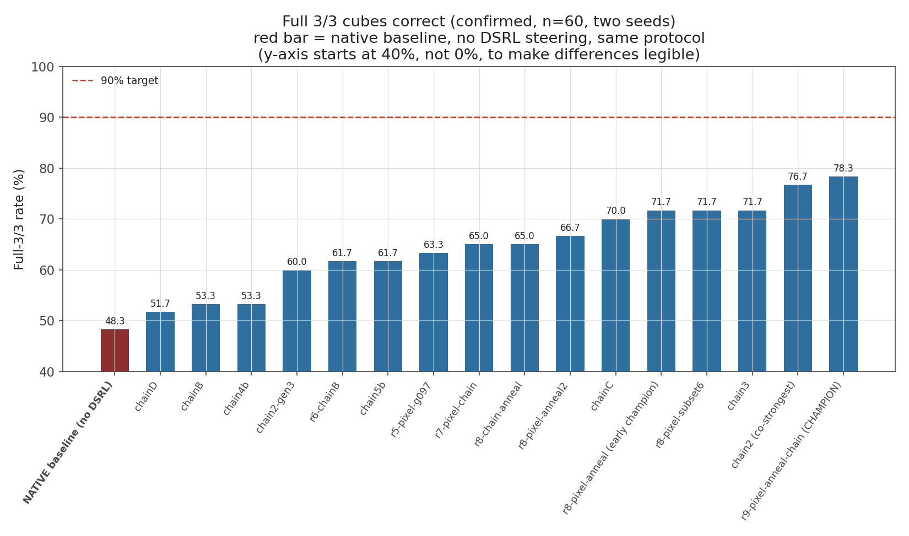

# DSRL on GR00T: steering a frozen humanoid VLA with reinforcement learning

**Diffusion steering via RL (DSRL) applied to NVIDIA's GR00T N1.7 on a Unitree
G1 humanoid.** A SAC agent learns to choose the initial noise of the VLA's
flow-matching action head. The VLA's weights are never updated. On a
three-cube colour-sorting task in MuJoCo, with the robot driven by its
deployed whole-body controller, the agent raises full-task success from
**48 % to 78 %** and per-cube success from **79 % to 89 %** (60 evaluation
episodes each).

<p align="center"></p>
<p align="center"><sub>Full-episode (3/3) success of every confirmed 60-episode evaluation. Native GR00T (red) is lowest; the champion reaches 78.3 %.</sub></p>

| policy (60 episodes, layout 0) | per-cube placed | full 3/3 | wrong basket |
|---|---|---|---|
| frozen GR00T N1.7 (its own noise) | 78.9 % | 48.3 % | 0 |
| **+ DSRL** | **88.9 %** | **78.3 %** | 0 |

Rollouts: [champion](results/videos/champion_rollout.mp4) ·
[native](results/videos/native_rollout.mp4). Details, files and caveats:
[results/README.md](results/README.md).

## How it works

```
             obs (joints, cube/basket geometry) + 84×84 ego view
                                  │
                           ┌──────▼──────┐
                           │  SAC agent  │  224-d action (right arm + hand, 16 rows)
                           └──────┬──────┘
          z = z_base + 1.5·a      │      z_base ~ N(0,1), redrawn every chunk
                                  ▼
 image + instruction ──► GR00T N1.7 (frozen) ──► 16-step action chunk (20 Hz)
                         flow matching from z           │
                                                        ▼
                               GEAR whole-body controller (50 Hz) ──► MuJoCo, G1 + Dex3
```

- **Residual partial-noise steering.** The agent adds a correction to 224 of
  the 5,280 seed dimensions: the right arm and hand, across the chunk's 16
  executed rows. The other 5,056 are resampled every chunk, so every seed
  stays on the distribution the model was trained to denoise from.
- **A critic that can rank actions:** an ensemble of 10 critics with a min over
  a random subset of 4, and a Q bound at the value of a perfect episode.
  Without it, Q saturated and nothing learned.
- **Vision, annealing, chaining:** a DrQ-style pixel encoder, learning-rate
  halving at each new best, and runs warm-started from previous bests.
- **Honest evaluation:** every number is an independent 60-episode
  confirmation on held-out seeds. 10-episode training evaluations overstate
  success by 20–30 points.

Method: [docs/method.md](docs/method.md). Campaign, findings and negative
results: [docs/campaign.md](docs/campaign.md). The single-process
simulator + controller + VLA environment and how it was validated against the
ROS deployment: [docs/sim_port.md](docs/sim_port.md).

## Setup

Requirements:
- Linux with an NVIDIA GPU and a CUDA 12.8 driver (each reported run used one
  80 GB A100);
- `git`, `git-lfs` and [`uv`](https://docs.astral.sh/uv/);
- a Hugging Face account that has accepted the licence of the gated base model
  `nvidia/Cosmos-Reason2-2B`.

```bash
git clone <this repo> && cd dsrl-gr00t
huggingface-cli login                 # or export HF_TOKEN=...
bash scripts/setup.sh                 # NVIDIA code + patches, .venv, GR00T checkpoint (~12.6 GB)
bash scripts/setup.sh --check
```

`setup.sh` fetches the two NVIDIA repositories at the tested commits into
`external/`, applies `patches/`, fetches only the model files the simulator and
controller load, builds a Python 3.10 environment from the pinned
`requirements.txt`, and downloads the fine-tuned GR00T N1.7 checkpoint
(weights only).

| external | what it provides | our patch |
|---|---|---|
| [NVIDIA/Isaac-GR00T](https://github.com/NVIDIA/Isaac-GR00T) @ `b995540` | GR00T N1.7 inference | `Isaac-GR00T_dsrl_noise.patch`: accept an injected initial noise (`options["dsrl_noise"]`) |
| [NVlabs/GR00T-WholeBodyControl](https://github.com/NVlabs/GR00T-WholeBodyControl) @ `b042411` | MuJoCo simulator, G1 model, whole-body controller, Unitree SDK | `GR00T-WholeBodyControl_dsrl_sim.patch`: cube-sorting scene, cube placement schedule, ego and wrist cameras, grasp smoothing |
| [rahul-ai-01/red_green_blue_cube_sorting_in_sim](https://huggingface.co/rahul-ai-01/red_green_blue_cube_sorting_in_sim) @ `b879ba5` | GR00T N1.7 fine-tuned on this task | — |

## Usage

```bash
# the frozen policy alone (native baseline)
GPU=0 scripts/baseline.sh --mode native --episodes 30 --layout 0 --max-chunks 120 --out native.jsonl

# train (runs/<timestamp>_<name>/: config.json, metrics.jsonl, checkpoints)
GPU=0 scripts/train.sh my-run 30000 env.max_chunks=120 sac.use_pixels=true \
    sac.critic_subset_size=4 sac.q_bound=45 sac.gamma=0.97 groot.resample_unsteered=true

# progress of every run
.venv/bin/python scripts/run_status.py

# confirm a checkpoint on fresh seeds
GPU=0 scripts/eval.sh runs/<run>/ckpt_best_<step>.pt --config runs/<run>/config.json \
    --max-chunks 120 --episodes 30 --seed 123
```

Any field of `dsrl/config.py` can be overridden as `group.field=value`. The
champion's exact recipe (three chained runs) is in
[results/README.md](results/README.md#reproducing). A 30k-step run averaged
about 14 GPU-hours on an A100.

## Repository layout

```
dsrl/
  config.py         every hyperparameter, with the finding behind each choice
  rl/train.py       training loop (python -m dsrl.rl.train)
  rl/sac.py         SAC with critic ensemble, subset-min, Q bound, LR annealing
  rl/sac_pixel.py   PixelSAC: DrQ-style encoder on the ego view
  env/sort_env.py   the cube-sorting environment: sim + controller + GR00T in one process
  sim/              whole-body-controller adapter, goal builder, initial pose
  groot/policy.py   seed-steerable wrapper around the frozen GR00T policy
  rewards.py        milestone reward
scripts/            setup, train, eval, baseline, run status
patches/            our changes to the two NVIDIA repositories
results/            the reported evaluations, figures and rollout videos
docs/               method, campaign findings, environment validation
external/           NVIDIA repositories (fetched by setup.sh)
```

`dsrl/env/stack_env.py` drives the same task on the four-process ROS/DDS
deployment instead (`--env stack`). `dsrl/rl/sac_na.py` implements DSRL's
noise-aliasing variant (`sac.use_noise_aliasing=true`). Neither was used for
the reported results.

## Limitations

- **Simulation only, one cube layout, privileged state.** The agent sees
  simulator cube positions in addition to pixels, and was not tested on other
  layouts or on the real robot.
- **The target was not reached.** The goal was 90 % full-episode success; the
  best confirmed result is 78.3 %. Ten-plus configurations cluster at
  80–85 % per-cube. Noise steering can only choose among behaviours the frozen
  policy already has: it fixes almost-successful episodes, but not a failed
  first grasp.
- **Selection effect.** The champion is the best of ~26 confirmed checkpoints
  evaluated on the same seeds, and it has no from-scratch replicates.

## Acknowledgements

DSRL is due to Wagenmaker et al.,
[*Steering Your Diffusion Policy with Latent Space Reinforcement Learning*](https://arxiv.org/abs/2506.15799)
(2025). GR00T N1.7 and the whole-body controller are NVIDIA's
([Isaac-GR00T](https://github.com/NVIDIA/Isaac-GR00T),
[GR00T-WholeBodyControl](https://github.com/NVlabs/GR00T-WholeBodyControl)).
The training campaign was run largely by an autonomous AI coding agent under
human direction ([docs/campaign.md](docs/campaign.md)).
